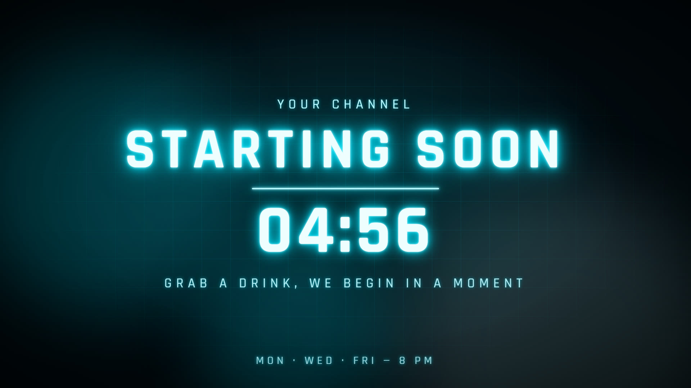
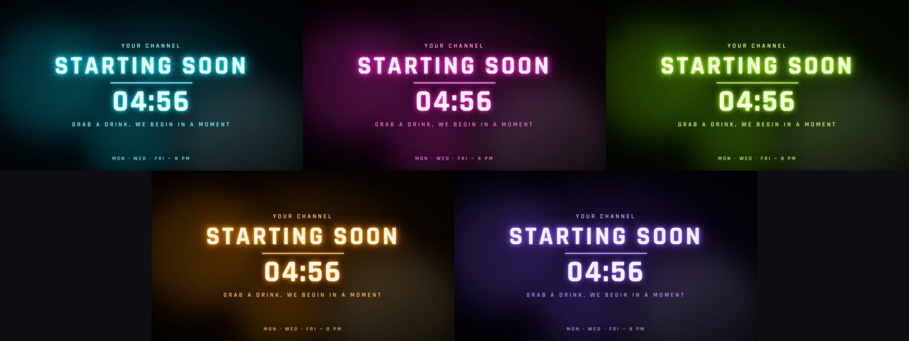
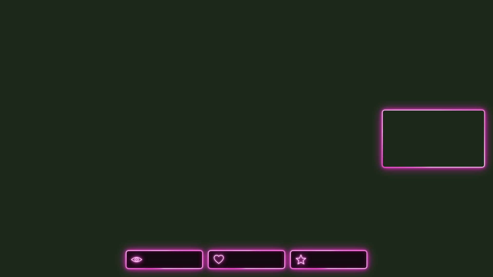
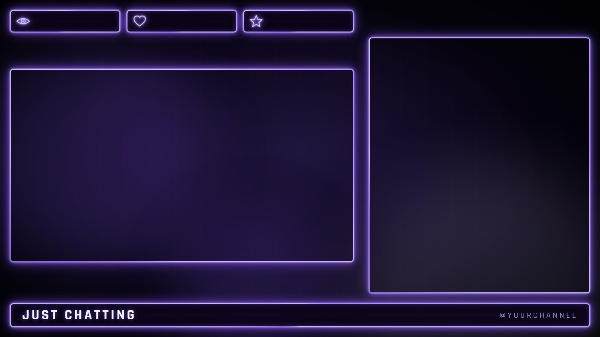

[English](README.md) | **Português**

# Stream Overlays

Overlays animados e editáveis para OBS Studio e Streamlabs Desktop. HTML, CSS e JavaScript puros, então não há nada para instalar: adicione cada arquivo como Fonte de Navegador e edite um único `config.js` para deixar tudo com a sua cara.

**[Prévia ao vivo](https://jnsdias.github.io/obs-overlay-packs/)** dos três pacotes no navegador (é uma demonstração; para usar os overlays, baixe os arquivos).

## Pacotes

| Pacote | Estilo | Pasta |
|---|---|---|
| **Clean** | Neutro e moderno, 5 presets de cor, efeitos ajustáveis | [`generic/`](generic) |
| **Neon** | Tubos de neon brilhantes, 5 presets de cor neon | [`neon/`](neon) |
| **Horror** | Sangue, títulos piscando, fonte Metal Mania | [`terror/`](terror) |

Todos trazem as mesmas cenas: Iniciando (com contagem regressiva), Em jogo, Just Chatting, Já volto (translúcido) e Fim da transmissão, mais fundos de alerta em loop (800×150) para Streamlabs ou StreamElements.

### Clean

Cinco presets de cor (roxo, azul, verde, vermelho e rosa), trocados com uma linha no `config.js`:

| Em jogo | Just Chatting |
|---|---|
|  |  |

### Neon

Cinco presets neon (ciano, magenta, lima, âmbar e violeta), também com uma linha no `config.js`:

| Em jogo | Just Chatting |
|---|---|
|  |  |

### Horror

| Em jogo | Just Chatting |
|---|---|
|  |  |

| Já volto | Fim da transmissão |
|---|---|
|  |  |

## Começando

1. Baixe este repositório (botão verde **Code**, depois **Download ZIP**) e descompacte num lugar definitivo.
2. Abra o `config.js` do pacote num editor de texto e defina o nome e o @ do seu canal.
3. No OBS: **Fontes, +, Navegador**. Marque **Arquivo local**, escolha um arquivo de cena (por exemplo `starting.html`) e defina **1920×1080**.

O guia completo está no README de cada pacote: ordem das camadas, tamanhos dos espaços, formatos de webcam, idiomas, efeitos e solução de problemas.

- [README do pacote Clean](generic/LEIAME.pt-BR.md)
- [README do pacote Neon](neon/LEIAME.pt-BR.md)
- [README do pacote Horror](terror/LEIAME.pt-BR.md)

## O que dá para mudar no `config.js`

Idioma (inglês ou português), nome e @ do canal, texto do horário, formato da webcam (16:9, 4:3, 1:1, 9:16), todas as frases de todas as cenas e, nos pacotes Clean e Neon, preset de cor, cores próprias e nível de efeitos. Tudo o que você edita é texto simples.

## Licença

Cada pacote tem o seu `LICENSE.txt` (em inglês). As fontes seguem a SIL Open Font License 1.1 (Rajdhani nos pacotes Clean e Neon, Metal Mania no Horror); as licenças delas ficam na pasta `fonts` de cada pacote.
