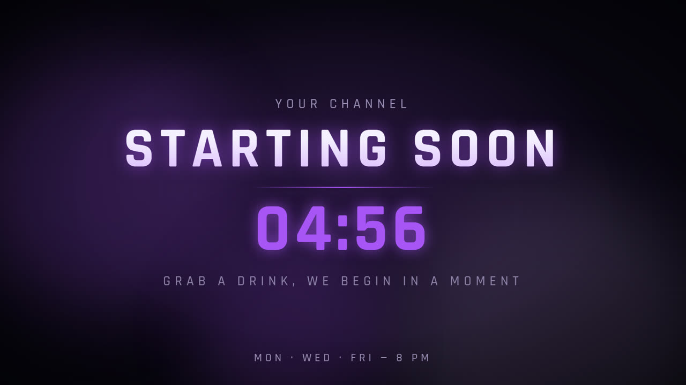
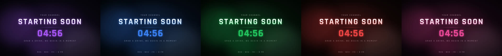
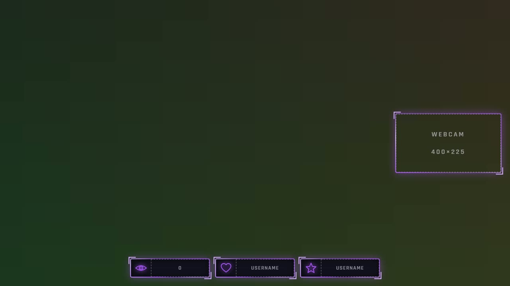
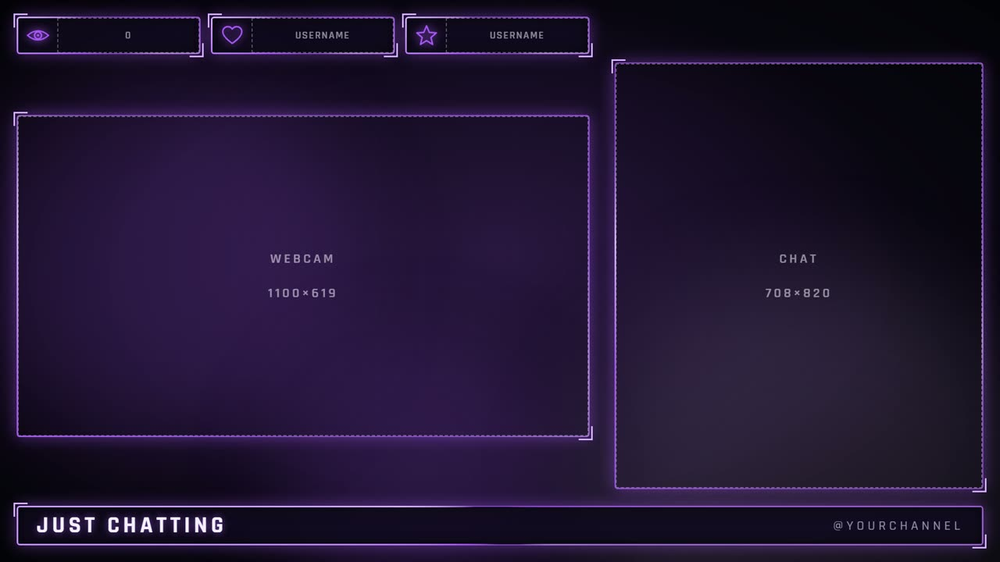
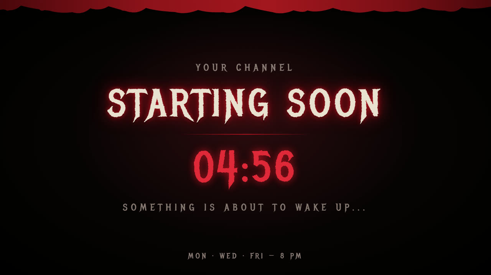
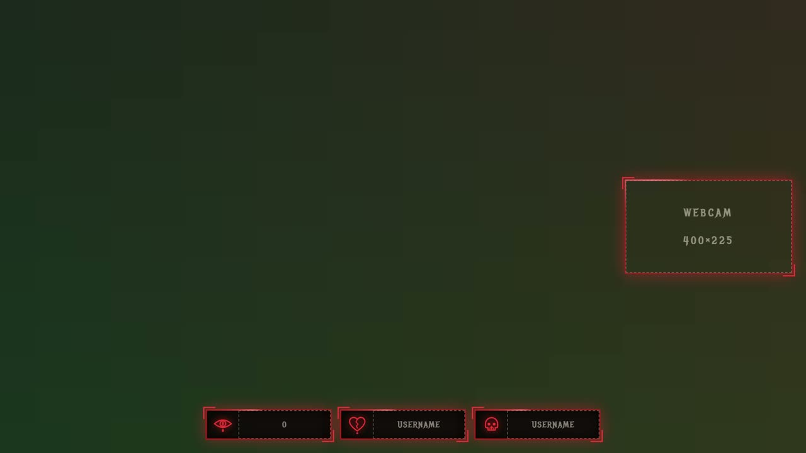
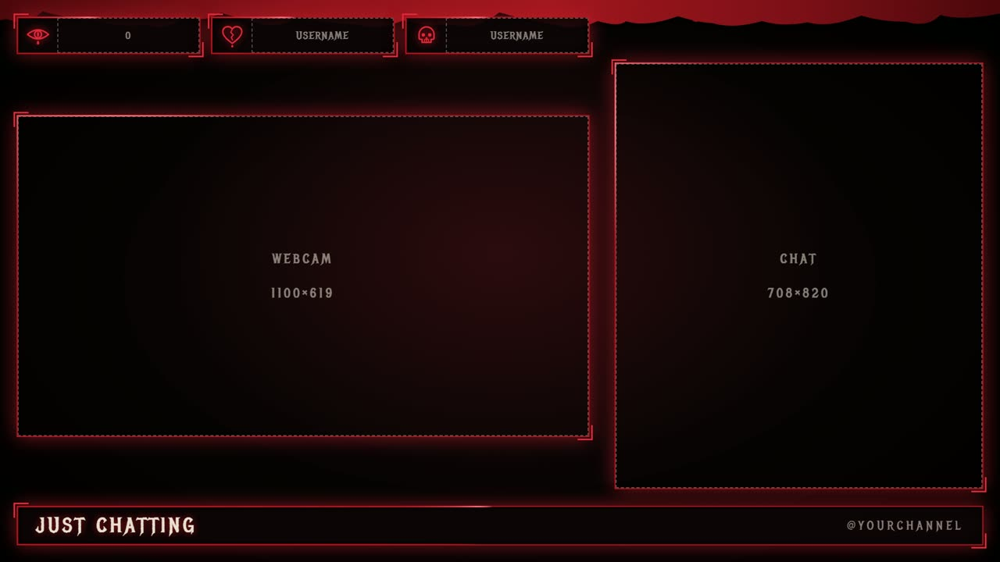
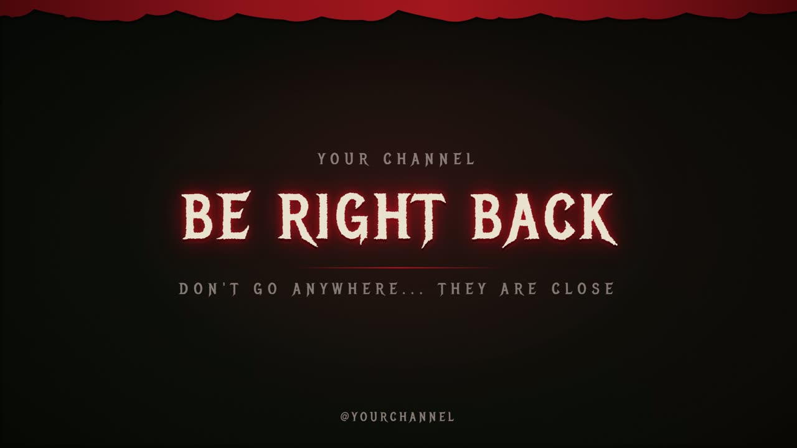
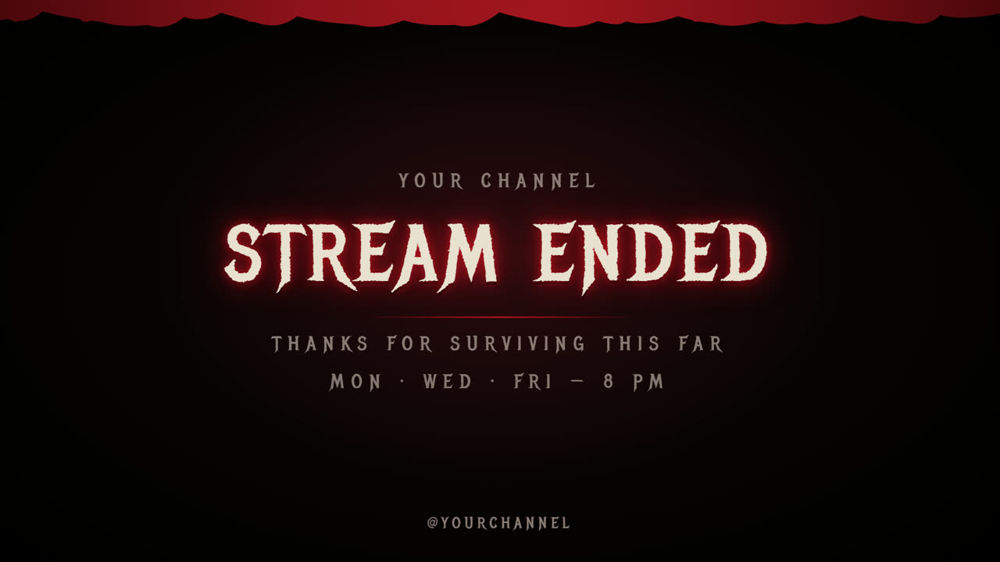

**English** | [Português](LEIAME.pt-BR.md)

# Stream Overlays

Animated, editable overlays for OBS Studio and Streamlabs Desktop. Plain HTML, CSS and JavaScript, so there is nothing to install: add each file as a Browser Source and edit one `config.js` to make it yours.

**[Live preview](https://jnsdias.github.io/obs-overlay-packs/)** of both packs in your browser (a demo; to use the overlays, download them).

## Packs

| Pack | Style | Folder |
|---|---|---|
| **Clean** | Neutral and modern, 5 color presets, adjustable effects | [`generic/`](generic) |
| **Horror** | Blood, flickering titles, Metal Mania font | [`terror/`](terror) |

Both include the same scenes: Starting Soon (with countdown), In Game, Just Chatting, Be Right Back (see-through) and Stream Ended, plus looping alert backgrounds (800×150) for Streamlabs or StreamElements.

### Clean

Five color presets (purple, blue, green, red, pink), changed with one line in `config.js`:

| In Game | Just Chatting |
|---|---|
|  |  |

### Horror

| In Game | Just Chatting |
|---|---|
|  |  |

| Be Right Back | Stream Ended |
|---|---|
|  |  |

## Quick start

1. Download this repository (green **Code** button, then **Download ZIP**) and unzip it somewhere permanent.
2. Open the pack's `config.js` in a text editor and set your channel name and handle.
3. In OBS: **Sources, +, Browser**. Tick **Local file**, pick a scene file (for example `starting.html`), and set **1920×1080**.

The full guide is in each pack's README: layer order, slot sizes, webcam shapes, languages, effects and troubleshooting.

- [Clean pack README](generic/README.md)
- [Horror pack README](terror/README.md)

## What you can change in `config.js`

Language (English or Portuguese), channel name and handle, schedule text, webcam shape (16:9, 4:3, 1:1, 9:16), every phrase on every scene and, in the Clean pack, color preset, custom colors and effect level. Anything you edit is plain text.

## License

Each pack has its own `LICENSE.txt`. Fonts are under the SIL Open Font License 1.1 (Rajdhani in the Clean pack, Metal Mania in the Horror pack); their licenses are in each pack's `fonts` folder.
